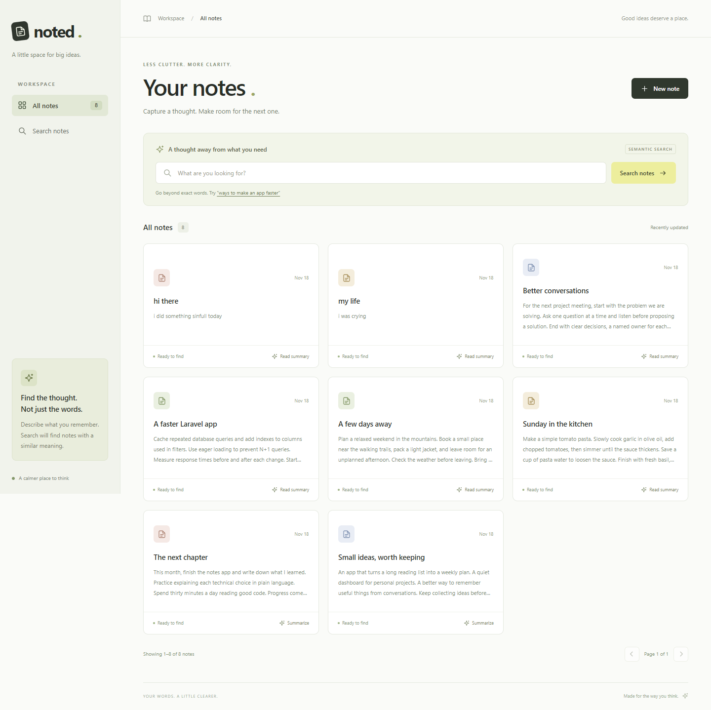

# Noted — AI Notes

A Laravel notes app with MySQL persistence, semantic search through Google Gemini Embedding 2, and saved AI summaries with model fallback. The frontend uses Blade, CSS, and plain JavaScript. There is no login: everyone opening this local app uses the same notes workspace.



## Requirements

- PHP 8.2 or later with `pdo_mysql`, `curl`, `openssl`, and `mbstring` enabled.
- Composer, Node.js, and npm.
- MySQL or XAMPP's MariaDB service.
- A Google AI Studio API key with access to the configured models. Their free tiers have usage limits.

## Local setup

1. Start MySQL in XAMPP.
2. Create the database. On this Windows setup:

   ```powershell
   & C:\xampp\mysql\bin\mysql.exe -u root -e "CREATE DATABASE IF NOT EXISTS ai_notes CHARACTER SET utf8mb4 COLLATE utf8mb4_unicode_ci;"
   ```

3. Install dependencies and create the local environment file if it does not already exist:

   ```powershell
   composer install
   Copy-Item .env.example .env
   npm install
   ```

   Keep an existing configured `.env` instead of overwriting it.

4. Configure `.env`:

   ```dotenv
   DB_CONNECTION=mysql
   DB_HOST=127.0.0.1
   DB_PORT=3306
   DB_DATABASE=ai_notes
   DB_USERNAME=root
   DB_PASSWORD=

   GEMINI_API_KEY=your_google_api_key
   GEMINI_EMBEDDING_MODEL=gemini-embedding-2
   GEMINI_SUMMARY_MODELS=gemini-4-hydrogen,gemini-3.8-flash,gemini-3.7-flash,gemini-3.6-flash,gemini-3.1-flash-lite
   GEMINI_EMBEDDING_DIMENSIONS=768
   GEMINI_MINIMUM_SIMILARITY=0.65
   GEMINI_QUERY_CACHE_SECONDS=3600
   GEMINI_MODEL_COOLDOWN_SECONDS=300
   GEMINI_SUMMARY_TIMEOUT_SECONDS=6
   ```

5. Generate an application key on a fresh install, migrate, and build the frontend:

   ```powershell
   php artisan key:generate
   php artisan config:clear
   php artisan migrate
   npm run build
   php artisan serve --host=127.0.0.1 --port=8000
   ```

6. Open **http://127.0.0.1:8000**. For frontend development, run `npm run dev` in a second terminal instead of rebuilding after each change.

Optional sample notes:

```powershell
php artisan db:seed --class=DemoNoteSeeder
```

The seeder saves six editable examples and requests their real embeddings. It does not delete existing notes or overwrite existing titles. All samples can be deleted through the app.

### Local HTTPS certificates

If PHP reports cURL error 60, configure a valid CA bundle. This XAMPP installation already provides one:

```dotenv
GEMINI_CA_BUNDLE=C:/xampp/apache/bin/curl-ca-bundle.crt
```

Leave this setting empty on systems where PHP's default certificate configuration works. HTTPS certificate verification stays enabled. Run `php artisan config:clear` after changing `.env`.

## How the code works

```text
Blade page + plain JavaScript
             |
             v
Laravel API routes -> Form Request validation -> Controllers
                                                   |
                              +--------------------+-------------------+
                              v                                        v
                          Note model                         GoogleAiService
                              |                                        |
                              v                                        v
                            MySQL                                Google Gemini API

Semantic search: query embedding + saved note embeddings -> NoteSearchService
```

- `routes/api.php`: API URLs and rate-limit middleware.
- `app/Http/Requests`: note, pagination, and search validation.
- `app/Http/Controllers/NoteController.php`: normal CRUD and saving notes before requesting embeddings.
- `app/Http/Controllers/NoteAiController.php`: search, summaries, and retrying pending embeddings.
- `app/Services/GoogleAiService.php`: the only place making Google API calls; includes the actual prompts and response validation.
- `app/Services/NoteSearchService.php`: a readable loop implementing cosine similarity and ranking results.
- `app/Http/Resources/NoteResource.php`: the JSON fields returned to clients. Raw vectors are not included.
- `resources/views/notes/index.blade.php`: page, note cards, and dialogs.
- `resources/js/app.js`: frontend API calls and UI events.
- `resources/css/app.css`: page styling and responsive layouts.

No additional runtime PHP packages, vector database, queues, or Redis are required. Laravel's existing framework and HTTP client handle the backend.

## Database schema

The application's custom data lives in one table, `notes`:

| Column | Type | Purpose |
| --- | --- | --- |
| `id` | bigint, primary key | Note identifier |
| `title` | varchar(255) | Required title |
| `content` | text | Required note, up to 12,000 characters |
| `summary` | nullable text | Completed AI summary |
| `summary_model` | nullable varchar(255) | Model that produced a new summary |
| `embedding` | nullable JSON | Array of 768 numbers from Google |
| `embedding_model` | nullable varchar(255) | Model used to create that vector |
| `created_at`, `updated_at` | timestamps | Creation and modification times |

`updated_at` is indexed for listing. The standard Laravel scaffold's users, cache, and jobs migrations remain, but the notes app does not use user accounts, database sessions, or queues. Sessions and rate-limit cache use local files.

Notes are saved to MySQL before making an embedding request. If Google fails, the API still confirms the save and includes a warning. The UI marks the note as search pending and provides a **Prepare for search** button in the note dialog.

Editing the title or content clears the old embedding, summary, and summary model. The backend then generates an embedding for the new content. Summaries are created on demand, persisted in the same row, and reused on subsequent summary requests.

### Summary fallback and caching

For an uncached summary, Laravel tries models in this order and stops at the first complete response:

1. `gemini-4-hydrogen`
2. `gemini-3.8-flash`
3. `gemini-3.7-flash`
4. `gemini-3.6-flash`
5. `gemini-3.1-flash-lite`

Each summary attempt has a 6-second timeout. Unavailable models are skipped for 5 minutes before being tried again. The chosen model is saved as `summary_model`. The order, timeout, and cooldown are configurable in `.env`.

Caching uses the existing Laravel file cache, with no extra service to install:

- Completed summaries and note embeddings are reused from MySQL until the note changes.
- Search-query embeddings are cached for one hour, keyed by query, model, and dimension count. Search results are still computed from current database rows, so edits and deletions appear immediately.
- Model failures have a short cooldown to avoid retrying busy models for every note.

Run `php artisan cache:clear` to clear the temporary file cache. This leaves notes, saved summaries, and stored note embeddings in MySQL.

## API documentation

Base URL: `http://127.0.0.1:8000/api`. Send `Accept: application/json`; JSON writes also use `Content-Type: application/json`.

| Method | Endpoint | Result |
| --- | --- | --- |
| GET | `/notes?page=1&limit=10` | Paginated notes, recently updated first |
| POST | `/notes` | Save a note and attempt its embedding; HTTP 201 |
| GET | `/notes/{id}` | One note |
| PUT / PATCH | `/notes/{id}` | Update a note; send both title and content |
| DELETE | `/notes/{id}` | Delete a note; HTTP 204, empty body |
| GET | `/notes/search?q=faster%20website&page=1&limit=10` | Semantic matches, highest similarity first |
| POST | `/notes/{id}/summary` | Generate and save a summary, or return the saved summary |
| POST | `/notes/{id}/embedding` | Prepare a saved note for search; reuse a compatible existing embedding |

Create or update body:

```json
{
  "title": "Laravel performance",
  "content": "Cache repeated database queries and use eager loading to avoid N+1 queries."
}
```

Create/update response:

```json
{
  "message": "Note created.",
  "data": {
    "id": 1,
    "title": "Laravel performance",
    "content": "Cache repeated database queries and use eager loading to avoid N+1 queries.",
    "summary": null,
    "summary_model": null,
    "search_ready": true,
    "created_at": "2026-11-18T10:00:00.000000Z",
    "updated_at": "2026-11-18T10:00:01.000000Z"
  },
  "warning": null
}
```

Single-note responses use `{ "data": { ... } }`. Lists use Laravel's `data`, `links`, and `meta` structure. `meta` includes `total`, `current_page`, `last_page`, `per_page`, `from`, and `to`. Search results additionally include each note's `similarity` value. It is a cosine score, not a confidence percentage.

Validation:

- `title`: required string, at most 255 characters.
- `content`: required string, at most 12,000 characters.
- `q`: required search string, at most 500 characters.
- `page`: positive integer; default 1.
- `limit`: integer from 1 to 50; default 10.

Errors use JSON with a `message`. Validation errors also include `errors` keyed by field name. Status codes: 422 for invalid input, 404 for an unknown note, 429 for the app's rate limit, 503 for unavailable Google access or quota, and 502 for malformed or incomplete provider output.

### Semantic search

1. Save a note, then request its 768-dimensional embedding from `gemini-embedding-2`.
2. Store the embedding and model name in MySQL.
3. Embed the search query using the same model and dimension size.
4. Compare it against compatible, prepared notes using cosine similarity in PHP.
5. Keep results at or above `GEMINI_MINIMUM_SIMILARITY`, sort descending, and paginate.

This is a real embedding search, rather than SQL keyword matching. A query such as “ways to make a website respond faster” can retrieve a note about caching and database indexes. Pending notes are excluded until their embedding is ready.

The default similarity threshold is a starting point. Search quality depends on the actual notes and queries. If you change the embedding model or dimension count, old vectors are excluded and notes must be prepared again.

## Security and scope

- All Google calls run in Laravel. The browser only talks to the local Laravel API.
- The API key stays in `.env`, which is excluded by the existing `.gitignore`; `.env.example` contains a placeholder.
- Eloquent binds database values, and inputs pass through Form Requests.
- Note text and AI output are inserted into the page using `textContent`.
- The app limits general API requests to 120/minute/IP and AI-related requests to 15/minute/IP.
- Provider response bodies, note contents, and API keys are not logged or returned in provider errors.
- This assignment intentionally uses a shared workspace without authentication. Run it locally as configured.

## Tests

Create a dedicated test database:

```powershell
& C:\xampp\mysql\bin\mysql.exe -u root -e "CREATE DATABASE IF NOT EXISTS ai_notes_testing CHARACTER SET utf8mb4 COLLATE utf8mb4_unicode_ci;"
php artisan test
```

`phpunit.xml` explicitly selects `ai_notes_testing`, with local XAMPP credentials. Adjust those test credentials if your MySQL setup differs. Tests reset and use this separate database, never `ai_notes`. Google requests are faked and unexpected external calls are blocked in the API tests.

The suite covers persistence, CRUD, input validation, pagination, similarity ranking, cached summaries, model fallback order, model cooldown expiry, query-cache expiry, current search results after database changes, pending-embedding retries, provider outages, invalid responses, and rate limiting.

Frontend checks:

```powershell
node --check resources/js/app.js
npm run build
```

## AI usage and prompts

See [AI_USAGE.md](docs/AI_USAGE.md) for development tools, representative development prompts, exact runtime prompts, and validation details.

## Screenshots and demo

- [Desktop workspace](docs/screenshots/desktop.png)
- [Mobile workspace](docs/screenshots/mobile.png)
- [A saved AI summary](docs/screenshots/summary.png)

Suggested demo: create a note about caching, reload the page to show persistence, search for “ways to make an app faster,” generate its summary, edit the note, then delete it.

## Practical limits

- Cosine search scans prepared notes in PHP. This keeps a small assignment understandable; a much larger dataset would need indexed vector retrieval.
- AI actions require internet access and available Google quota. Existing notes remain usable when Google is unavailable.
- `npm audit` currently reports an upstream `picomatch` advisory in the existing Vite development dependencies, with no patched version listed. A normal `npm audit fix` does not resolve it. The app does not accept user-supplied glob patterns. See [GHSA-fc5q-39xc-vjpf](https://github.com/advisories/GHSA-fc5q-39xc-vjpf).

Git and Docker setup are intentionally left out as requested.
